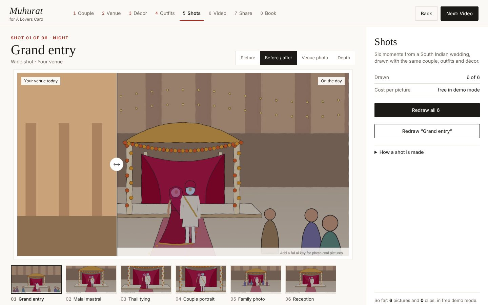

# Muhurat — wedding previews for A Lovers Card

Muhurat lets a couple see their wedding before they book it. They add a few photos of themselves and their venue, choose their tradition, muhurat time, décor and outfits, and get six matching pictures of their own rituals. The pictures become a short wedding film, a before/after of their real venue, a save-the-date card and a link the family can vote on. The look they approve becomes a priced décor list that vendors can quote on.

This repository is the working MVP, built by PathAxiom for A Lovers Card.

| | |
| --- | --- |
| **Stack** | Next.js 15 (App Router) · React 19 · TypeScript · Tailwind CSS · SQLite with Drizzle ORM |
| **AI, free** | [Cloudflare Workers AI](https://developers.cloudflare.com/workers-ai/): FLUX.2 [klein] 4B for real pictures, about 80 a day at ₹0. [Setup guide](docs/FREE_AI_SETUP.md) |
| **AI, paid** | [fal.ai](https://fal.ai): Nano Banana Edit for pictures, Depth Anything V2 for venue depth, Wan 2.2 for clips |
| **Runs without AI keys** | Yes. Demo mode draws storyboard sketches so every screen works offline and for free |
| **Tests** | 49 automated tests (Vitest), including full pipeline tests on the demo and free settings |



---

## Quick start (5 minutes)

You need **Node.js 20.18 or newer** (22 recommended).

```bash
git clone https://github.com/adarshninamdar99/muhurat-mvp.git
cd muhurat-mvp
npm ci
cp .env.example .env.local
npm run dev
```

Open http://localhost:3000, type two names, press **Start**, and walk through the eight steps.

The database file and uploaded photos are created automatically under `./data/` (git-ignored).

### Switch on real AI for free

Follow **[docs/FREE_AI_SETUP.md](docs/FREE_AI_SETUP.md)** (about 5 minutes, no card). In short, in `.env.local`:

```
AI_PROVIDER=cloudflare
CLOUDFLARE_ACCOUNT_ID=your-account-id
CLOUDFLARE_API_TOKEN=your-workers-ai-token
```

### Or use paid AI (real depth and real video)

1. Create a key at https://fal.ai/dashboard/keys and add credit to the account.
2. In `.env.local` set:
   ```
   AI_PROVIDER=fal
   FAL_KEY=your-key-here
   ```
3. Restart `npm run dev`.

Pictures now come from fal.ai at about ₹3.50 each, and clips at about ₹9 each. Every call is logged with its cost on the admin page (`/admin`, username `admin`, password from `ADMIN_PASSWORD`).

---

## What the app does

| Step | Screen | What happens behind it |
| --- | --- | --- |
| 1 | **Couple** | Names, 1–5 photos per person (cleaned to JPEG, max 2048 px), **tradition** (North Indian, South Indian, Bengali, Marathi) and **muhurat** time (dawn, morning, golden hour, night) |
| 2 | **Venue** | Optional venue photo is saved and a **depth map** job runs in the background |
| 3 | **Décor** | Colours, flowers, mandap and lighting are saved. Drawn shots are flagged “out of date” |
| 4 | **Outfits** | Bride and groom outfits are saved (optionally linked to catalogue photos) |
| 5 | **Shots** | Six pictures of the tradition's own rituals (for example malai maatral and thali for South Indian). The first (“Grand entry”) is the **anchor**: every other shot gets it as a reference so décor and outfits match. Above the picture, **Before / after** slides between the empty venue photo and the drawn wedding |
| 6 | **Video** | A 5-second clip from any finished shot, plus **Our wedding film**: all shots stitched with slow camera moves, title cards and a tanpura drone made in the browser, downloadable as a video |
| 7 | **Share** | A **family link** where relatives tap ♥ on favourites (counts show on the filmstrip), and a **save-the-date card** from the portrait (PNG download or share) |
| 8 | **Book** | A priced décor list is built from the choices, and a vendor quote request is saved |

The film, before/after, card and family votes run in the browser or on the app's own server, so they are free on every setting.

---

## Project map

```
src/
├── app/                     Pages and API routes (Next.js App Router)
│   ├── page.tsx             Home: start a preview, recent previews
│   ├── p/[id]/[step]/       The 7-step studio (one URL per step)
│   ├── admin/               Cost and usage dashboard (password protected)
│   └── api/                 JSON API used by the screens (see docs/API.md)
├── components/
│   ├── studio/              Studio screens: frame, picture viewer, filmstrip
│   │   └── panels/          One file per step’s right-hand panel
│   ├── home/                Home page form
│   └── ui/                  Shared building blocks (Button, ChoiceGrid, Toast…)
├── config/
│   ├── catalog.ts           ★ Every option a couple can choose. Edit here first.
│   └── pricing.ts           AI prices per call (USD)
├── lib/                     Code shared by server and browser (types, API client, formatting)
├── server/                  Server-only code (never sent to the browser)
│   ├── env.ts               Settings from .env, checked at start-up
│   ├── db/                  Database tables (schema.ts) and connection
│   ├── storage/             Saving files to disk; cleaning uploaded photos
│   ├── ai/                  AI providers, prompts and the provider contract
│   │   ├── prompts.ts       ★ The text sent to the AI. Tune wording here.
│   │   └── providers/       fal (real AI) and mock (demo mode)
│   ├── jobs/                Background job queue, worker and handlers
│   └── services/            Business logic: projects, shots, clips, quotes, costs
├── instrumentation.ts       Starts the job worker when the server starts
└── middleware.ts            Password prompt for /admin
drizzle/                     Database migrations (generated, committed)
tests/                       Automated tests
docs/                        Architecture, AI pipeline, editing guide, API, deployment
```

**Rule of thumb:** screens live in `components/`, rules live in `server/services/`, choices live in `config/catalog.ts`.

---

## Common changes

| I want to… | Edit |
| --- | --- |
| Add a décor theme, flower, outfit, shot, tradition, muhurat time or camera move | `src/config/catalog.ts` |
| Change the wedding film or save-the-date design | `src/components/studio/film/draw.ts`, `src/components/studio/share/saveTheDate.ts` |
| Change the wording sent to the AI | `src/server/ai/prompts.ts` |
| Use a different fal.ai model | `src/server/ai/providers/fal/models.ts` (+ input in `fal/index.ts`) |
| Update AI prices | `src/config/pricing.ts` |
| Change colours or fonts | `tailwind.config.ts` |
| Change décor price ranges | `VENDOR_LINES` in `src/config/catalog.ts` |
| Add a database column | `src/server/db/schema.ts`, then `npm run db:generate` |

Step-by-step recipes: **[docs/EDITING_GUIDE.md](docs/EDITING_GUIDE.md)**.

---

## Scripts

| Command | What it does |
| --- | --- |
| `npm run dev` | Development server with hot reload on http://localhost:3000 |
| `npm run build` / `npm start` | Production build and server |
| `npm run check` | Type-check + lint + tests (run before every pull request) |
| `npm test` | Tests only |
| `npm run db:generate` | Create a migration after changing `schema.ts` |
| `npm run db:migrate` | Apply migrations (also happens automatically at start-up) |
| `npm run db:studio` | Browse the database in your browser |

---

## Documentation

- **[Architecture](docs/ARCHITECTURE.md)**: how the pieces fit, the data model, the job queue, design decisions
- **[Free AI setup](docs/FREE_AI_SETUP.md)**: real AI pictures at no cost with Cloudflare, step by step
- **[AI pipeline](docs/AI_PIPELINE.md)**: models, prompts, costs, consistency strategy, limits, how to swap models
- **[Editing guide](docs/EDITING_GUIDE.md)**: recipes for the most common changes
- **[API reference](docs/API.md)**: every endpoint with examples
- **[Deployment](docs/DEPLOYMENT.md)**: running it on a server, backups, scaling path
- **[Contributing](CONTRIBUTING.md)**: code conventions and the pull-request checklist

---

## A note on the stack

The proposal described a Python (FastAPI) back end. For the MVP we built everything in one TypeScript codebase on Next.js instead: one language, one server to run, one set of types shared by the screens and the API. The AI work runs through fal.ai, so no Python model code is needed yet. If later work needs custom model training or self-hosted GPUs, that can be added as a separate Python service behind the same `AiProvider` interface (see docs/AI_PIPELINE.md).
