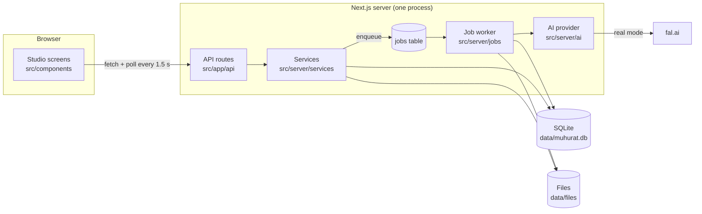
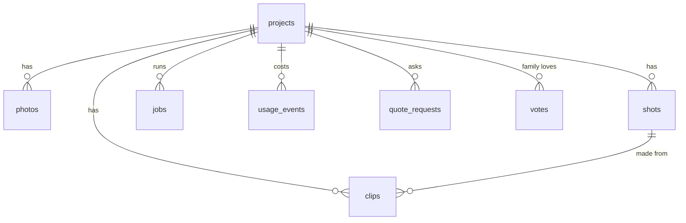
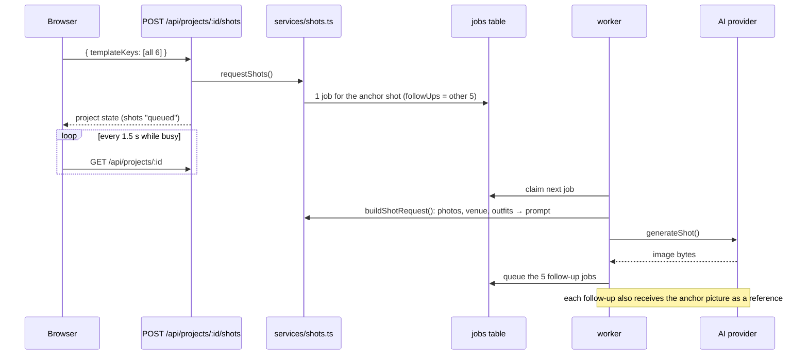

# Architecture

Muhurat is one Next.js application. The same server renders the pages, answers the JSON API, and runs a background worker that calls the AI service. Data lives in a SQLite file and uploaded/generated files live on disk.

## Layers and their rules

| Layer | Folder | Knows about | Must not |
| --- | --- | --- | --- |
| Screens | `src/components`, `src/app/**/page.tsx` | `src/lib` (types, API client), `src/config` | Import anything from `src/server` (except server pages loading initial state) |
| API routes | `src/app/api` | Services, `src/server/http.ts` | Contain business rules: validate input, call a service, return JSON |
| Services | `src/server/services` | Database, storage, job queue, catalog | Know about HTTP or React |
| Jobs | `src/server/jobs` | Services, AI providers | Be called directly from routes (always go through the queue) |
| AI providers | `src/server/ai` | Only their own SDK | Touch the database or disk |
| Config | `src/config` | Nothing | Contain secrets (it is bundled into the browser) |

Every file under `src/server` starts with `import "server-only"`, so Next.js refuses to build if one is accidentally imported into browser code.

## Data model

| Table | One row is | Key fields |
| --- | --- | --- |
| `projects` | One couple's preview | names, 9 selection keys (from the catalog, including tradition and time), venue photo and depth paths, `share_token` |
| `photos` | A photo of the bride or groom | person, path, size |
| `shots` | One picture for one template (unique per project + template) | status, image path, `selection_hash`, prompt used |
| `clips` | A video made from a shot | camera move, status, video path, `preview_only` |
| `jobs` | One piece of background work | type, JSON payload, status, attempts, progress text, error |
| `usage_events` | One AI call | provider, model, kind, cost in USD and INR, duration |
| `quote_requests` | A request for vendor quotes | line items (JSON), totals |
| `votes` | One family member's ♥ on one shot | template key, voter ID (random, from their browser), optional name; unique per project + shot + voter |

Schema: `src/server/db/schema.ts`. Migrations: `drizzle/`. They are applied automatically when the server starts.

## How a shot is made (request → picture)

### Why the anchor shot comes first

Generative models do not remember earlier pictures. To keep décor, colours and outfits the same across six pictures, the first picture (the **anchor**, “Grand entry”) is made first, and every other shot receives it as an extra reference image with the instruction “match its décor, colours, flowers, outfits and lighting exactly”. The couple's face photos are sent with every shot as well.

### Out-of-date detection

When a shot finishes, it stores a `selection_hash`: a fingerprint of the nine selections, the venue photo and the couple's photo IDs. If any of these change afterwards, the stored hash no longer matches, and the shot shows **Out of date**. The screen then offers one button to redraw exactly those shots. Nothing is redrawn automatically, because each redraw costs money.

## The job queue

- Jobs are rows in the `jobs` table: `queued → running → done | failed`.
- The worker (`src/server/jobs/worker.ts`) starts with the server via `src/instrumentation.ts` and runs `JOB_CONCURRENCY` jobs at a time.
- A failing job is retried once. After the second failure the handler's `onFailure` marks the shot or clip as failed with a readable message, and the error is listed on the admin page.
- If the server restarts mid-job, jobs left `running` go back to `queued` at start-up.

**Limit:** the worker lives inside the web server process, so the app must run as one long-lived Node.js process (a VM, a container, Railway, Render, Fly.io). It does not suit serverless platforms where processes freeze between requests. See [DEPLOYMENT.md](DEPLOYMENT.md) for the scaling path.

## How the screens stay up to date

The studio is a client component (`src/components/studio/Studio.tsx`) that receives the full project state from the server page, then:

1. calls the API for every user action and replaces its state with the response, and
2. while anything is queued or running, polls `GET /api/projects/:id` every 1.5 seconds (`useProjectState.ts`).

One state object (`ProjectState` in `src/lib/types.ts`) feeds every panel, so there is no separate client store to keep in sync.

## Design decisions

| Decision | Why | Revisit when |
| --- | --- | --- |
| One TypeScript codebase (no separate Python API) | One language, shared types, one process to run | Custom training or self-hosted GPUs are needed |
| SQLite + Drizzle | Zero setup, a single file to back up, typed queries | Several app servers or heavy write traffic (move to Postgres, see DEPLOYMENT.md) |
| Files on local disk behind a 4-function storage module | Simplest possible; swapping to S3/R2 touches one file | Running more than one server |
| DB-backed job queue in-process | No Redis to run; survives restarts | Thousands of jobs per hour or several workers |
| Polling instead of WebSockets | Simple and reliable; jobs take seconds to minutes | Many concurrent users watching jobs |
| Demo provider in the same interface | Every screen and test works without an AI account | Never: keep it for tests and local development |
| Selections stored as catalog keys | Options can be renamed or re-priced without a migration | Options need per-vendor data (move the catalog to the database) |
